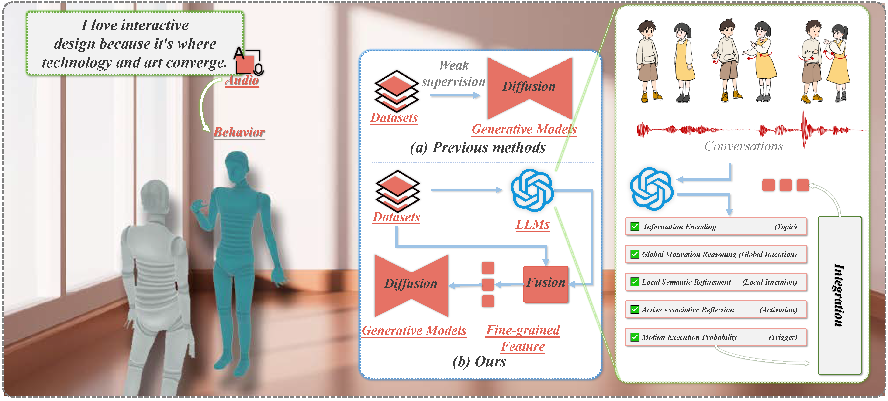

# ECHO

<p align="center">
  
</p>

Enhancing Conversational Behavior Generation via Hierarchical Semantic Comprehension with Large Language Models.

> “Through linguistic research, we can break down cultural barriers and promote mutual understanding and cooperation between different civilizations.” — Ji Xianlin

> “通过语言学研究，我们可以打破文化隔阂，促进不同文明之间的相互理解与合作。” — 季羡林

---

## Core Method

### Pain Points

1. Existing approaches primarily rely on audio signals and interlocutor motions to drive the main agent’s behavior, lacking high-level semantic understanding of dialogue content; resulting motions are moderate in quality and not sufficiently context-aware.
2. Weak supervision from audio–motion pairs struggles to capture the rich hierarchical semantics present in conversations.
3. Many methods depend on small-window local context and lack the capacity to process entire dialogue flows, limiting long-term context understanding.

### Solution

Echo frames LLMs as semantic processing units. With tailored prompts, it extracts fine-grained semantic information (including global topics, global intentions, sentence-level local intentions, activation states, motion execution probabilities, etc.). A hierarchical feature fusion network progressively integrates frame-level (audio, motion, etc.), sentence-level (local semantics), and dialogue-level (global semantics) features, seamlessly plugging into existing motion generation models to produce more natural, contextually aligned behaviors.

This repository adopts a prompt-driven analysis workflow, enabling rapid iteration across different analytic angles while remaining reproducible and easy to extend.

## Environment Setup

```bash
git clone https://github.com/Echo-Motion/Echo.git
cd Echo
pip install -r requirements.txt
```

## Dataset Preparation

Refer to [the paper](https://arxiv.org/abs/2308.12646) and organize your dataset as follows:

```text
twh_genea2023_dataset/
├── processed
│   ├── trn
│   │   ├── interloctr
│   │   │   ├── npy_text
│   │   │   ├── npy_bvh
│   │   │   └── npy_audio
│   │   └── main-agent
│   │       ├── npy_text
│   │       ├── npy_bvh
│   │       └── npy_audio
│   └── val
│       └── ...
└── raw
    ├── trn
    │   ├── interloctr
    │   │   ├── wav
    │   │   ├── tst
    │   │   └── bvh
    │   └── main-agent
    │       └── ...
    └── val
        └── ...
```

## Data Processing Workflow

Step 1. Normalize raw conversation logs and save to a standard intermediate format.
```bash
python main_codes\1step_LLM_fork_new.py
```

Step 2. Read and validate data; check structural consistency.
```bash
python main_codes\2step_LLM_fork_reader.py
```

Step 3. Merge conversation segments/windows, preparing for k-conversation extraction.
```bash
python main_codes\3step_LLM_fork_merge.py
```

Step 4. Extract k-conversation windows for focused analysis.
```bash
python main_codes\4step_get_k_conversation.py
```

Step 5. Serialize windows and metadata, preparing LLM requests.
```bash
python main_codes\5step_read_k_conversation.py
```

## Request LLM API

Run Stage 6 to request LLMs and generate multi-angle analyses.
```bash
python main_codes\6step_ChappieLLM.py
```

Note: configure API keys to ensure successful requests. Experimental outputs are being prepared for release.

## Prompt Suite

All prompts are under `main_codes\prompt\` and can be edited or replaced.

## Testing & Utilities

- `use_kimi.py` — example request (Kimi interface)
- `llm_tools.py` — request helpers/tools
- `count_token.py` — token counting and cost estimation
- `AK.py` — API key storage/loading (adjust to your environment)

## Generation Model Integration

- Diff https://github.com/JeremyCJM/DiffSHEG
- DSG https://github.com/YoungSeng/DiffuseStyleGesture
- Follow the project instructions, download weights, and integrate LLM-derived information for training.

```bash
python sum_diff_echo_end2end.py
```

## Rendering

Two rendering methods are provided.

Method 1: fast skeleton generation (run in order)
```bash
python Rendering Codes/approach1_step1_viz_new.py
python Rendering Codes/approach1_step2_sample_Video.py
python Rendering Codes/approach1_step3_merge_samples_video.py
```

Method 2: original full rendering
```bash
python Rendering Codes/approach2_render_bvh.py
```


## Citation

```bibtex
@inproceedings{Xue2025Echo,
  title={Echo: Enhancing Conversational Behavior Generation via Hierarchical Semantic Comprehension with Large Language Models},
  author={Xue, Haiwei and Fan, Yanbo and Wang, Xuan and Wu, Zhiyong},
  booktitle={Proceedings of SIGGRAPH Asia 2025},
  year={2025}
}
```
